### Olá, eu sou o Rian Oliveira! 👋

**Estudante de Análise e Desenvolvimento de Sistemas | UniBH**

📍 Belo Horizonte, MG · 🎯 Em busca de estágio em TI

[LinkedIn](https://www.linkedin.com/in/rian-oliveira-a45b132b5/) · [E-mail](mailto:rianolivera1738.com@gmail.com)

---

### 👨‍💻 Sobre mim

Estudo **ADS na UniBH** e desenvolvo projetos para aprimorar minhas habilidades em programação, redes e segurança da informação. Tenho interesse em **back-end, suporte técnico e cibersegurança**.

### 🚀 Projetos

- **[Diagnóstico de Rede no Linux](https://github.com/rianolivera1738com-cmd/diagnostico-rede-bash)** — Script Bash para verificar IP, gateway, conexão e DNS.
- **[Avaliador de Senhas em Java](https://github.com/rianolivera1738com-cmd/AvaliadorDeSenha-Java)** — Avaliação didática de critérios de segurança de senhas.
- **[API de Segurança](https://github.com/rianolivera1738com-cmd/api-de-seguranca)** — API com ASP.NET Core, SQLite, JWT e biblioteca Rust para hashes de senhas.

### 🛠️ Tecnologias em estudo

**Java · C# · Rust · Bash · Linux · Git/GitHub · Redes**

---

Aprendendo, praticando e construindo projetos.

